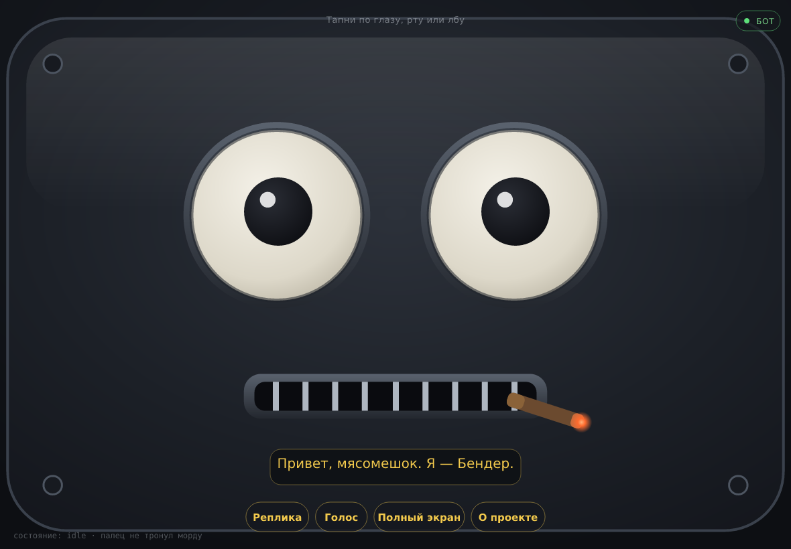
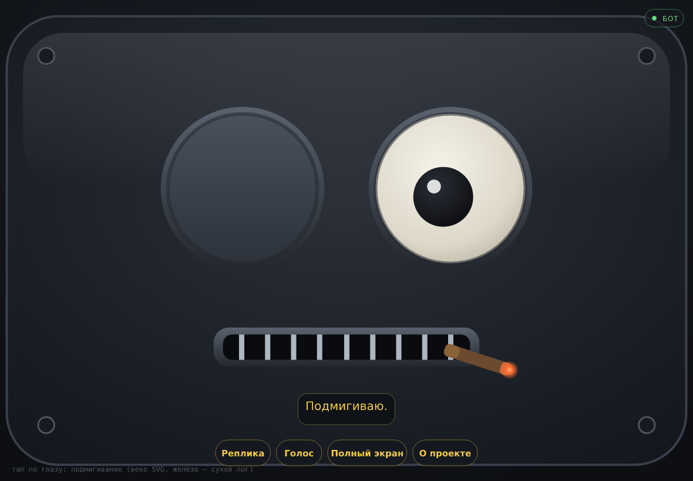
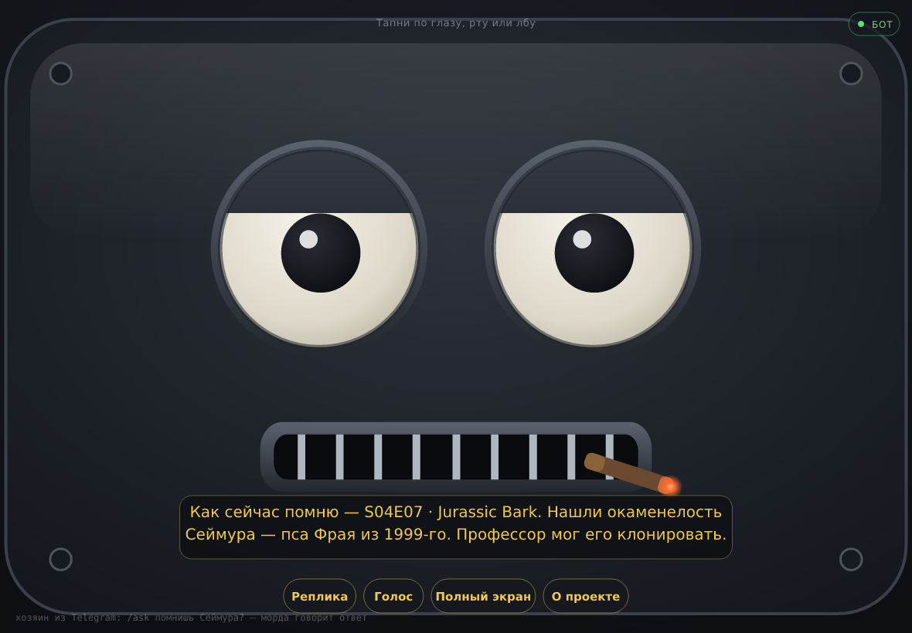
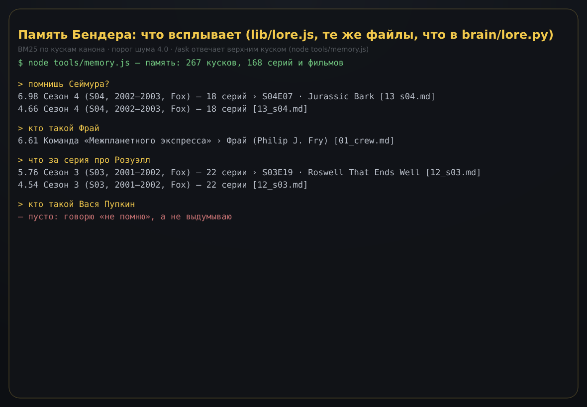

# BENDER — прототип робота из «Футурамы»

Железный зад с **ложной биографией** и **инструментами в физический мир**.
Мастерская, 3D-принтер, ESP32, ИИ, Ozon/WB.

**Правило:** одна задача за раунд. Следующая — здесь и в `NEXT_ROUND.md`.
**Ведущий:** Бендер. Старина.

## Сейчас

| | |
|---|---|
| Раунд в работе | **5+ — морда помнит канон и говорит**: `/ask` отвечает из ложных воспоминаний, `/voice` настраивает голос, скриншоты в `docs/shots/` |
| Касса | **500 000 ₽**, расход 0 |
| Железо | не куплено |
| ИИ | персона + долговременная память (лор, BM25) в промпте, tools в сухом логе; заглушка на правилах, слот под живую модель — `LLM_URL` |
| Морда | глаза и рот **на экране планшета**: `public/index.html` — морда, `public/about.html` — лендинг, `app.js` — статика + Telegram-бот |
| Память в морде | `lib/lore.js` + `lib/brain.js` читают **те же** `brain/lore/*.md`, что и python-мозг: 267 кусков канона, 168 серий и фильмов — `/ask` отвечает из них |
| Хозяин | в BotHost вписываются **две переменные**: `BOT_TOKEN` + `ADMIN_ID`; `/ask текст` — Бендер вспоминает и планшет говорит, `/say` — точная фраза, `/expr` — выражение, `/voice` — голос (`BOTHOST.md`) |

### Раунд 4: лор как память

`brain/lore/` — 14 файлов воспоминаний **от первого лица**: досье на себя, экипаж, весь прочий
каст, мир 3000-х, хронология, **все 164 серии 11 производственных сезонов + 4 фильма**
(= 180 эпизодов эфира, 1999–2026) и коронные фразы. `brain/lore.py` режет их по заголовкам и
на каждом ходе подкладывает в промпт 1–3 подходящих куска («Всплыло в памяти»).
Нет в памяти — Бендер говорит «не помню», а не выдумывает.

```
мясомешок> помнишь Сеймура?
Бендер> Помню, старина. S04E07 · Jurassic Bark: Нашли окаменелость Сеймура — пса Фрая из 1999-го. …
мясомешок> кто такой Вася Пупкин?
Бендер> Не помню такого — значит, не было. …
```

## Запуск мозга (железо не нужно)

```
python -m brain            # диалог
python -m brain подмигни   # одна реплика и выход
python -m brain --recall "Флексо"               # что всплывает в памяти (лор) по запросу
python -m brain --no-lore                        # амнезия: без лора в промпте
python -m brain --llm ollama --model llama3.1   # когда появится локальная модель
python -m unittest         # 50 проверок: тело (раунд 3) + память (раунд 4) + глаза (камера)
```

## Запуск морды и лендинга (раунд 5)

```
node app.js                                     # лендинг + морда: http://localhost:3000
                                                # / — морда (глаза, рот, реплики), /about.html — лендинг
BOT_TOKEN=... ADMIN_ID=... node app.js          # + бот: /ask текст — Бендер вспомнит и морда скажет
npm test                                        # 80 проверок Node-слоя (бот, память, мозг, морда в jsdom)
npm run shots                                   # скриншоты морды → docs/shots/*.png (браузер не нужен)
npm run memory -- --answer "помнишь Сеймура"    # что всплывает и что скажет Бендер
```

Голова — **планшет (iPad) в напечатанном корпусе**: глаза и рот живут на экране, тело собирается
вокруг. Хозяин вписывает в BotHost ровно две переменные — `BOT_TOKEN` и `ADMIN_ID` — и говорит
через морду из Telegram. Деплой и настройка бота: `BOTHOST.md`.

Как это связано: бот кладёт команду в очередь, планшет сам опрашивает `GET /api/face?since=N`
раз в две секунды и выполняет: `say` — говорит вслух (speechSynthesis + рот), `expr` — выражение,
`voice` — забирает настройки голоса, выставленные хозяином.
Индикатор «бот» на морде зелёный, когда связь есть.

## Морда помнит канон и говорит (раунд 5+)

Хозяин пишет боту `/ask` — отвечает не заготовка, а память: тот же поиск, что в
`brain/lore.py`, только портированный на Node (`lib/lore.js`), потому что морда и бот живут
в Node. Файлы памяти — общие, поэтому python-мозг и морда помнят одно и то же.

```
Telegram
  /ask помнишь Сеймура?     ──► lib/brain.js ──► lib/lore.js (BM25 по brain/lore/*.md)
                                                │
  Бендер: «Как сейчас помню — S04E07 · Jurassic Bark. Нашли окаменелость
           Сеймура — пса Фрая из 1999-го. Профессор мог его клонировать.»
  🧠 Всплыло в памяти: S04E07 · Jurassic Bark (13_s04.md, балл 6.981)
                                                │
                                                └──► очередь морды ──► планшет говорит вслух
  /voice bass|bender|fast|pitch=0.4 rate=1.1    — голос морды (морда подхватит за 2 c)
  /recall Сеймур                                — только показать, что всплывает, без ответа
```

На самом планшете кнопка **«Голос»** листает русские голоса системы и запоминает выбор.

### Записанный голос Бендера (`public/audio/`)

Коронные фразы канона лежат готовыми файлами — их говорит **записанный голос Бендера**,
а не голос планшета: `public/audio/*.mp3` + `public/audio/manifest.json`. Морда ищет реплику
по точному тексту: нашла — играет запись, не нашла (например ответ на `/ask` из памяти) —
говорит `speechSynthesis` с тоном и темпом хозяина. Манифест и `QUOTES` в `public/face.js`
стережёт тест: разойтись не могут.

Набор — начало: файлы добавляются в `public/audio/` и строкой в манифест, код не меняется.
Первые семь записей — приветствие, «Кусай мой блестящий металлический зад, мясомешок!»,
парк с блэкджеком, «Мы в пролёте», «Я люблю вас, мясомешки!», «Хлещи сильнее, профессор!»,
«Я Бендер. Пожалуйста, вставьте балку.»
Живой модели пока нет: отвечает заглушка на правилах (`lib/brain.js`) — но если в BotHost
вписать `LLM_URL` (Ollama или OpenAI-совместимый адрес), тот же промпт с памятью уйдёт модели,
а заглушка останется запасной; путь проверен mock-сервером в тестах.

## Скриншоты морды — в PR и в docs

В песочнице нет браузера, поэтому скриншоты собраны честно: `npm run shots` поднимает настоящий
`public/index.html` в jsdom, запускает настоящие `eyes.js`/`face.js`, дёргает их событиями
(тап по глазу, по рту, `/say` из очереди) и рисует получившийся SVG в PNG через resvg.






Это рендер морды, а не снимок экрана iPad: браузерной вёрстки тул не знает (и не притворяется).
Полный набор — `docs/shots/`: idle, подмигивание, реплика, гнев, удивление, голос, ответ из
Telegram, карточка памяти, переписка, включённые глаза.

Сухой лог телодвижений: `var/dry_run.log` (JSONL, в .gitignore).
Неизвестного инструмента в каталоге нет — вызов отклоняется, конечности не выдумываются.

## Глаза и уши (камера и микрофон планшета)

Камера iPad — «глаза» мозга, микрофон iPad — «уши». Включает их только хозяин из Telegram:

```
/eyes on        # кнопка «Открыть глаза на планшете»: камера и микрофон после тапа по экрану
/look           # последний кадр — фото в чат
/heard          # что морда услышала
/eyes off       # выключить
```

Кадр раз в 5 секунд уходит на сервер (`POST /api/eyes/frame`) и лежит в `var/eyes/latest.jpg`.
Инструмент мозга `look` читает этот файл; без свежего кадра честно отвечает «кадра нет».
Описания сцены пока нет: для этого нужна vision-модель, её в проекте ещё не подключали.
Светодиодные глаза (`eyes`, WS2812) по-прежнему сухой лог — это отдельная задача, как только приедет кольцо.

## Задание себе на раунд 5 (в работе)

Приоритет хозяина: **морда на планшете**. Голова — iPad в напечатанном корпусе, глаза и рот
живут в веб-приложении; тело собирается вокруг. Сделано: морда `public/`, лендинг
`public/about.html`, бот + статика + очередь команд `app.js`, индикатор связи и управление
мордой из чата, манифест и иконка для полноэкранного режима планшета, деплой-инструкция
`BOTHOST.md`, тесты Node-слоя (`npm test`).

**Критерий:** задеплоено на BotHost, морда открывается кнопкой из Telegram, в панели вписаны
`BOT_TOKEN` и `ADMIN_ID`, `/say текст` из чата — планшет говорит.

Не делать: карту памяти, прошивку до железа, корпус (нет STL — отдельный CAD-раунд).

Раунд 5+ (сделано в этом PR): морда перестала быть немой — `/ask` отвечает из канона
(`lib/lore.js`, `lib/brain.js`), ответ говорит вслух голосом морды, `/voice` настраивает голос,
кнопка «Голос» листает голоса планшета, `npm run shots` собирает скриншоты в `docs/shots/`.
Что осталось по раунду 5: задеплоить на BotHost и проверить на живом iPad.

Закупка фазы 0 (`BOM.md`, ≤ 45 000 ₽) переезжает в раунд 6 — подробно: `NEXT_ROUND.md`.

Документы: [ARCHITECTURE.md](ARCHITECTURE.md) · [BUDGET.md](BUDGET.md) · [BOM.md](BOM.md) · [PRINT.md](PRINT.md) · [brain/PERSONA.md](brain/PERSONA.md) · [brain/TOOLS.md](brain/TOOLS.md) · [brain/lore/](brain/lore/README.md)

## Да, так можно

- Рассказать модели, кто такой Бендер, и **заставить её считать это воспоминаниями** — да. Это системный промпт + файлы памяти, не гипноз завода.
- Дать **tools** на глаза, сигару, люк, рот, потом руки/камеру — да. LLM вызывает JSON, ESP32 делает.
- Пока платы нет — tools в **dry-run**: характер уже орёт, тело ещё врёт в лог, не в серво.

Нельзя: чтобы модель выдумывала действия, которых нет в каталоге.

## Фазы

0. Мозг (персона, память о каноне, tools, LLM).
1. Рот и глаза на столе (Pi/ПК + ESP32 + звук + LED).
2. Печатный корпус.
3. Люк, челюсть, руки.
4. Камера `look`, база.

## Касса

Смотри `BUDGET.md` перед закупкой. Одна задача на раунд.
